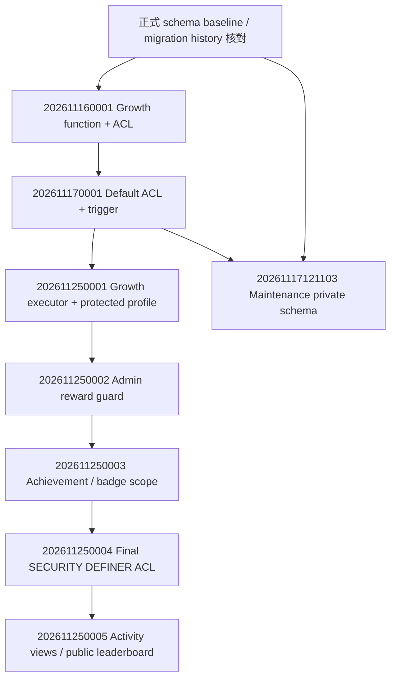

# Smart Class Migration 依賴矩陣與正式環境相容性審查 v1.0

> 日期：2026-11-28（Asia/Taipei）  
> Repository：`johnjohn114/smart-class`  
> 候選來源分支：`integration/growth-registration-and-reward-security-20261125`  
> 候選來源 commit（目前核對）：`ec8ccfd58a4c0d853e4c82734aedf63d1e9faec8`  
> 正式 Supabase project：`fsoowongtavlsrwvzbze`  
> 性質：唯讀正式 catalog 核對 + SQL/測試原始碼審查 + CI 結果核對。  
> **決策：HOLD。此矩陣是審查文件，不是 Migration 執行順序核准。**

## 1. 本輪結論

1. 正式 PostgreSQL 為 17.11；應用 Migration ledger `supabase_migrations.schema_migrations` 不存在。Auth、Realtime、Storage 的內部 migration ledger 不能代表網站應用 Migration 歷史。
2. 正式 DB 目前有 Migration 004 預期盤點的 36 個 public SECURITY DEFINER 函式名稱；逐名唯讀查詢結果均為恰好 1 個 overload，且均為 SECURITY DEFINER。這降低了 004 的 inventory mismatch 風險，但不能代替函式簽章、body、ACL、呼叫端與完整 schema 的最終比對。
3. 正式 DB 有 `profiles`、`growth_levels`、`growth_point_transactions`、`competition_attendance`、`activity_member_stats`；沒有 `growth_points_executor`，也沒有 `activity_public_leaderboard`。正式 `postgres` role 的 `rolcreaterole=true`。
4. 候選 CI 在 commit `6f661d9d156b88396c1eb6cef40097960c8b49f2` 的兩個 workflow 均成功：Maintenance workflow 4/4 jobs、Notification workflow 2/2 jobs。CI 使用 disposable PostgreSQL/GoTrue/PostgREST fixtures，不是正式 44 表 schema 的完整 restore rehearsal。
5. 尚有 migration baseline、managed-role 差異、supabase_admin default ACL、外部 service_role 消費者、公開排行榜告知/授權等阻擋事項。

## 2. Migration 分類矩陣

| Migration | 類別 | 主要前置條件 / 依賴 | 主要影響 | 本輪決策 |
|---|---|---|---|---|
| `202610310001_app_releases.sql` | 歷史 schema SQL | 正式 app_releases 現況與此設計吻合 | 建立 app_releases、RLS、索引 | 不重播；尚無 applied 歷史證據 |
| `20261031_app_releases.sql` | 衝突變體 | 與上一份是替代設計，不是前後依賴 | `is_latest`、不同 helper/索引/欄位 | 不可當第二份 Migration 執行 |
| `26.11.3_calendar_fields.sql` | 歷史 schema SQL | announcements 現有表及欄位 | 四個行事曆欄位、檢查限制與 partial index | 現況吻合；不重播、不 repair |
| `202611160001_growth_function_authorization_hardening.sql` | 成長/權限基礎層 | 完整既有 profiles/growth/competition/orders/support/videos 等表、36 個既有 SECURITY DEFINER 函式及相符簽章；`public.is_admin()`、`public.is_admin_user()` 等 helper | 替換多個函式、全體 public SECURITY DEFINER ACL allowlist、postgres-owned function default EXECUTE | 必須先完成完整 schema/function body/呼叫端 diff；不是單純權限小修 |
| `202611170001_default_privileges_and_trigger_hardening.sql` | default ACL / trigger 層 | Migration 160001 的應用角色及 public schema；既有 visitor_accounts/profiles trigger | 限縮 postgres 在 public 的未來 table/sequence/function defaults；修正 visitor profile upsert；撤銷 trigger-only 函式直接 EXECUTE | 建議在 160001 後；確認 migration owner 為 postgres |
| `20261117121103_maintenance_system_initial.sql` | 獨立維護系統 | `public.is_admin()` 存在且 authenticated 可執行；private schema/RPC 名稱不存在；Data API 不暴露 private | 建立 private 六表、RLS、五個 SECURITY INVOKER RPC | 與成長系統不同工作流；baseline 完成後獨立部署 |
| `202611250001_protect_profile_fields_growth_system_updates.sql` | 成長積分核心修補 | 160001 建立 `_refresh_growth_level_internal(uuid)`；profiles 保護 trigger 與成長表/欄位存在；postgres 可建立受限 role 並轉移 function ownership | 建立 NOLOGIN BYPASSRLS 的 `growth_points_executor`；三個 growth functions 改由此 role 擁有；保護 trigger 允許僅限成長欄位更新；重寫簽到/發獎/結算流程 | 需在 160001 後；170001 建議先完成；高風險 ownership 變更 |
| `202611250002_admin_growth_reward_null_auth_guard.sql` | 管理員 RPC guard | 兩個 admin reward RPC 已存在且簽章相符 | 重寫兩個函式並暫時 grant service_role | 與 160001 已有 NULL-auth guard 有重複，需說明保留理由；004 會再撤銷 service_role |
| `202611250003_growth_achievement_user_scope_guard.sql` | 會員範圍 guard | growth achievement/badge 表與 `award_growth_points` 存在；呼叫端依賴 self/admin 行為 | 重寫兩個會員成就/徽章 RPC，收緊 target-user 範圍；暫時 grant service_role | 160001 已有大部分本人/管理員檢查；需明確記錄實際行為差異，避免無理由重複重寫 |
| `202611250004_security_definer_execution_scope_guard.sql` | 最終 ACL 層 | 36 個函式名稱各恰好一個 SECURITY DEFINER overload；001 的 growth executor ownership 已完成；所有呼叫端已盤點 | 撤銷 API roles 對 service_role/anon/PUBLIC 的直接 EXECUTE，依分類保留 authenticated、anon is_admin 與 download counter；調整 search_path | 應在 001–003 後；不得在外部 service_role 消費者未核實前上線 |
| `202611250005_activity_member_stats_and_public_leaderboard.sql` | View / 公開資料投影 | 正式既有 `activity_member_stats`、profiles.nickname、attendance 欄位與 grants/RLS | member view 設 security_invoker；新增五欄公開排行榜 | 建議最後；公開個人活動統計須先完成告知/適用授權 |

## 3. 建議依賴圖（僅為審查建議）

- 這張圖表示保守的候選順序，不表示所有箭頭都是 PostgreSQL 物件層的硬性依賴。
- 維護系統是獨立工作流；它不需要 growth executor，也不需要 activity leaderboard。圖中將它放在 170001 後只是便於統一 default ACL 與部署治理。
- `202611250005` 依賴既有 `activity_member_stats`，但不依賴維護系統。
- `202611250004` 是 002/003 暫時 service_role grants 的最終收斂層。若只執行前面其中幾份而未執行 004，最終 ACL 會與整組候選設計不同。

## 4. 重要的重複與版本差異

### 4.1 Migration 002 與 160001 的重複

160001 已定義 `admin_delete_growth_reward` 與 `admin_upsert_growth_reward` 的 NULL identity / 非 admin 防護（`auth.uid() IS NULL OR caller_role IS DISTINCT FROM 'admin'`）。002 再次建立相同用途的兩個函式，並暫時授予 service_role；004 最後又撤銷 service_role。

**建議：** 在保留 002 前，補上明確的行為差異說明。若沒有可驗證差異，應考慮在候選分支整理掉重複 Migration/測試，避免維護兩份相同函式定義。

### 4.2 Migration 003 的實際差異

160001 已對 `check_growth_achievements` 與 `check_activity_badges` 檢查登入身分及跨會員 admin 權限。003 的一個可辨識行為差異是：明確傳入 NULL 的 `check_growth_achievements(NULL)` 會改成檢查自己的帳號，而 160001 版本會回傳 0。這項 API 語意變更應寫進規格並測試；不要只描述成「補上原本完全缺少的本人/管理員檢查」。

### 4.3 Migration 004 與 160001 的分工

160001 已建立 public SECURITY DEFINER 的 fail-closed allowlist，並保留 `is_admin()` 的 anon 執行以支援 public RLS policies；但其主要 revoke 未全面撤銷 service_role 的既有 EXECUTE。004 的額外工作是撤銷 admin/member RPC 的 service_role EXECUTE、撤銷 trigger/internal/helper 的直接 API EXECUTE，並再次設定安全 search_path。

### 4.4 Default ACL 的 owner 範圍

160001/170001 的 ALTER DEFAULT PRIVILEGES 都是針對 `postgres` owner。正式 catalog 同時存在 `supabase_admin` 擁有的 default ACL；候選 SQL 明確不修改它們。因此：
- 不可宣稱所有 schema/所有 owner 的未來物件都已改成 opt-in。
- 需要確認正式 Migration 執行者與應用物件 owner 是預期的 `postgres`。
- `storage` 的 schema-specific default grants 不會因 revoke global PUBLIC EXECUTE 而自動消失。
- 若有物件由 `supabase_admin` 建立，須另外檢查其預設 ACL，不能推定受 170001 保護。

## 5. 權限與呼叫端風險

### 5.1 Growth executor

001 建立 `growth_points_executor NOLOGIN BYPASSRLS`，並把 `award_growth_points`、`refresh_growth_level`、`_refresh_growth_level_internal` 三個函式轉移給它。其 table grants 刻意限制為：
- profiles / growth_levels / growth_point_transactions SELECT；
- profiles 僅 UPDATE `growth_points`、`growth_level` 欄位；
- growth_point_transactions / notifications INSERT；
- public/auth schema usage、auth.uid() 與 is_admin() EXECUTE。

migration 暫時授予 postgres SET ROLE 以轉移 ownership，之後撤銷 SET。CI 有獨立 non-superuser CREATEROLE ownership-order 測試；正式 postgres role 目前 `rolcreaterole=true` 且 executor role 不存在。正式部署仍需驗證建立後 role membership、SET option、owner、ACL、column grants 與 trigger 行為。

### 5.2 SECURITY DEFINER 函式及 service_role

- 正式 DB 唯讀盤點的 36 個預期函式名稱全部各有一個 overload，且均為 SECURITY DEFINER。
- 候選 004 將 admin/member RPC 限定 authenticated；trigger-only functions 不可由 API roles 直接呼叫；growth internal functions 保留 postgres / executor 的內部呼叫路徑。
- 2026-11-28 候選來源文件記錄的 repository scan：create-visitor、reset-visitor-password、send-announcement-push 使用 service_role 做 table/Auth Admin 操作，未發現直接呼叫此組 SECURITY DEFINER RPC 的內部呼叫端。
- 這不包含第三方整合、其他 repository、手動 SQL、未追蹤程式或部署版本差異。**外部 service_role RPC consumers 仍是發布阻擋條件。**
- `increment_download_count(uuid)` 沒有函式內使用者身分檢查；004 將它保留給 anon/authenticated 的設計需要另外評估濫用/速率限制，不能把 EXECUTE ACL 當成 rate limit。

### 5.3 Trigger-only routines

170001/004 撤銷 trigger functions 對 API roles 的直接 EXECUTE。這不會刪除 trigger binding；完整 sequential CI 測試也會在撤權後插入 visitor_accounts 並檢查 profile/member_no trigger 是否仍執行。但正式環境仍需核對每個 trigger 的啟用狀態與實際綁定。

### 5.4 Maintenance private schema

維護 SQL 建立六張 private tables 與五個 SECURITY INVOKER RPC。private schema 的 RLS 和 grants 是必要但非唯一邊界；Dashboard 的 Data API Exposed schemas 必須人工確認不包含 `private`。SQL 內 public status RPC 對 anon 避免呼叫 `is_admin()`，只有 auth.uid() 非 NULL 時才判斷管理員。維護功能旗標維持關閉，直到部署和 smoke test 全部核准。

### 5.5 Public leaderboard

005 的公開 view 刻意公開 nickname、出席次數、遲到次數、未到次數、活動積分五欄，不公開 user_id 與內部積分小計。即使沒有帳號 UUID，暱稱和個人活動統計仍可能識別會員。必須完成明確告知及適用的會員/家長/學校授權或 opt-in；若無法確認，不得開放公開 view。

## 6. CI 證據與限制

在候選 commit `6f661d9d156b88396c1eb6cef40097960c8b49f2`：
- Maintenance Edge Function Checks：4/4 jobs 成功（Deno、GoTrue-issued JWT/PostgREST、完整 sequential growth release chain、isolated PostgreSQL RPC/RLS）。
- Notification Page Checks：2/2 jobs 成功（notification contract、isolated browser preview）。
- `full-growth-release-sequential.test.sql` 先套用 160001→170001 fixture，再建立最小應用 schema，依序套用 250001→250005，測試 ownership、ACL、trigger、報名獎勵、會員簽到、活動結算、view 權限。
- `growth-executor-managed-role-order.test.sql` 以非 superuser CREATEROLE migration role 測試 owner transfer 前後的 SET ROLE 權限。
- CI 並未以正式資料庫完整 44 tables/98 policies/所有 live constraints 和所有正式 function body 進行完整 restore。它也不會確認正式 Dashboard 的 Exposed schemas、正式 Edge secrets、外部 service_role 消費者或真實發布後行為。

## 7. 正式發布前必須補齊的證據

- [ ] 透過受控環境取得可信的完整 schema-only dump / CLI pull；核對 owner、ACL、default ACL、role membership、extensions、sequences、views、triggers、policies。
- [ ] 解決應用 Migration ledger 缺失；不手動建表、不虛構歷史 applied timestamp、不以結構相似直接 migration repair。
- [ ] 確認正式 Migration runner/物件 owner；確認 160001/170001 的 postgres owner scope 足以涵蓋實際建立物件者。
- [ ] 完成 160001 所替換函式的簽章、return type、body、呼叫端和所有 98 policies 依賴比對。
- [ ] 釐清 002 是否冗餘，並文件化 003 的 NULL-target API 行為變更。
- [ ] 確認 executor role 建立後的 owner、NOLOGIN、BYPASSRLS、membership SET/INHERIT/ADMIN OPTION、table/column grants。
- [ ] 完成所有外部 service_role RPC consumer 查證；不得只以 repository scan 當作完整證明。
- [ ] 逐一確認 trigger enabled/binding 及 anon/member/admin 的真實 JWT 行為。
- [ ] Dashboard 確認 private 不在 Data API Exposed schemas；maintenance Edge secrets/CORS/Gateway 驗證完成。
- [ ] Public leaderboard 的會員告知/授權與隱私決策完成。
- [ ] 在隔離環境演練備份還原與回滾；不要把反向 SQL 當成資料變更的安全回滾。

## 8. 本輪執行界線

本輪只讀取 GitHub 原始碼/測試/CI 結果，並對正式 Supabase 執行 SELECT catalog 查詢。沒有執行正式 DDL/DML、GRANT/REVOKE、Migration、migration repair、部署、PR merge 或付費操作。

**最終判定：候選 SQL 的主要依賴順序已可描述，36 個 SECURITY DEFINER 名稱與 executor role 建立前提也已做唯讀核對；但正式 baseline、owner/ACL 全量比對及外部消費者仍未完成，故維持 HOLD。**

## 2026-11-28 最新候選 head 與 CI 核對補充

- 本矩陣前段記錄的 commit `6f661d9d156b88396c1eb6cef40097960c8b49f2` 是當時的歷史檢查快照；目前 PR #41 head 已更新為 `ec8ccfd58a4c0d853e4c82734aedf63d1e9faec8`。
- 目前 head 的 Maintenance Edge Function Checks Run #603 與 Notification Page Checks Run #90 均成功；總計 6/6 jobs。
- 此 exact-head CI 不改變「HOLD」決策：CI 是隔離 fixture，不是完整正式 schema restore；migration baseline、managed Supabase 完整執行、外部 service_role 消費者與 leaderboard 隱私/告知仍未關閉。
- 重新唯讀查詢正式 DB：PostgreSQL 17.11；應用 migration ledger、private schema、maintenance objects、growth_points_executor、activity_public_leaderboard 均不存在；既有 app_releases/calendar 欄位現況未變。
